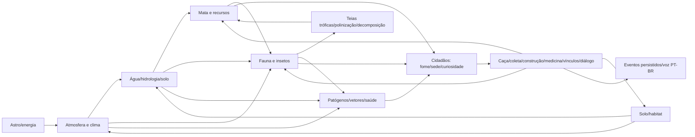

# Projeto Girassol 3.1.0 — Lote 1 consolidado

> **Documento único** de arquitetura, fundamentação, código-fonte de referência, testes e transição. O arquivo está em `GIRASSOL_LOTE_1_COMPLETO.md`. Repositório: [`conta14dinheiro-droid/Girassol-`](https://github.com/conta14dinheiro-droid/Girassol-).  
> **Escopo honesto:** o núcleo abaixo é uma fundação executável e determinística de simulação agregada, não uma previsão meteorológica, uma simulação molecular/estelar de alta fidelidade nem uma representação exaustiva de cada espécie. Fenômenos extremos são eventos estocásticos controlados, não previsões de que furacões/terremotos ocorram em qualquer mapa. Calibração regional e validação científica são trabalho contínuo.

## Índice

1. [Árvore lógica](#árvore-lógica)
2. [Arquitetura e grafo causal](#arquitetura-e-grafo-causal)
3. [Equações, cálculos e limites](#equações-cálculos-e-limites)
4. [Teoremas e demonstrações](#teoremas-e-demonstrações)
5. [Código C++20 completo do núcleo](#código-c20-completo-do-núcleo)
6. [Persistência SQLite WAL e migração](#persistência-sqlite-wal-e-migração)
7. [JNI, contrato de voz e Android/Compose](#jni-contrato-de-voz-e-androidcompose)
8. [Build e testes automatizados](#build-e-testes-automatizados)
9. [Referências e linhas de pesquisa](#referências-e-linhas-de-pesquisa)
10. [Lote 2](#lote-2)

## Árvore lógica

O repositório recebe intencionalmente **um só arquivo**; os caminhos abaixo identificam blocos a extrair para a estrutura real no Lote 2:

```text
Girassol-/
└── GIRASSOL_LOTE_1_COMPLETO.md   # documento único, código e instruções inclusos

Estrutura lógica futura (conteúdo especificado neste documento):
app/src/main/java/br/girassol/MundoScreen.kt
app/src/main/cpp/{CMakeLists.txt,girassol_core.hpp,girassol_core.cpp,jni_bridge.cpp}
native/tests/core_tests.cpp
native/CMakeLists.txt
.github/workflows/native.yml
```

## Arquitetura e grafo causal

Passo-base é de 1 hora simulada. Para estabilidade, o integrador divide o passo (`substeps`) conforme difusão/advecção e atualiza módulos na ordem causal; estado aleatório usa PRNG com semente persistida. SQLite guarda snapshots e eventos. UI apenas observa snapshots e envia comandos idempotentes. Sem rede; llama.cpp e modelos GGUF são dependências opcionais e locais, nunca requisito do núcleo.



Matriz de dependência (linha influencia coluna; influência reversa pode ter atraso):

|Origem → destino|Atmosfera|Água/solo|Flora|Fauna/insetos|Patógenos|Cidadãos/ações|Astro/energia|
|---|---:|---:|---:|---:|---:|---:|---:|
|Astro/energia|1|0|0|0|0|0|—|
|Atmosfera|—|1|1|1|1|1|0|
|Água/solo|1|—|1|1|1|1|0|
|Flora|1|1|—|1|0|1|0|
|Fauna/insetos|0|1|1|—|1|1|0|
|Patógenos|0|1|0|1|—|1|0|
|Cidadãos/ações|1|1|1|1|1|—|0|

`1` significa acoplamento com fluxo explícito. Exemplos de retorno: evapotranspiração resfria e umedece a camada limite; desmatamento altera albedo, rugosidade e infiltração; polinizadores alteram recrutamento vegetal; vetores dependem de água e temperatura; doença reduz trabalho/forrageamento; caça altera abundância e comportamento; casas mudam cobertura/impermeabilização. O modelo usa agregados por célula e grupo funcional, não entidades para cada organismo.

## Equações, cálculos e limites

### Clima e hidrologia

Variáveis por célula: temperatura do ar `T` [K], umidade específica `q` [kg/kg], pressão `p` [Pa], vento horizontal `u,v` [m/s], água de solo `W` [kg/m²], cobertura de nuvem `c∈[0,1]`, biomassa vegetal `B≥0`. Passo `Δt` [s]. Constantes: `σ=5.670374419e-8 W m⁻² K⁻⁴`, `c_p≈1004 J kg⁻¹ K⁻¹`, `L_v≈2.5e6 J kg⁻¹`, `ρ≈1.2 kg m⁻³`.

Pressão de vapor de saturação (aproximação de Tetens, intervalo meteorológico usual): `e_s(T_C)=610.94 exp(17.625 T_C/(T_C+243.04)) Pa`; `RH=clamp(q p/(0.622+0.378q)/e_s,0,1)`. Ponto de orvalho pode ser obtido invertendo essa relação. Não extrapolar Tetens a temperaturas extremas.

Balanço energético de camada: `C_T dT/dt = (1-α)(1-a)S + ε_a σT_a⁴ - ε_sσT⁴ + H_adv + L_v E - L_v C + Q_geo + Q_human`. Aqui `S` é irradiância incidente, `α` albedo, `a` atenuação por nuvens/aerossol, `E` evapotranspiração, `C` condensação, e `C_T` capacidade térmica areal. Integração explícita só com passo limitado; versão de produção deve usar esquema semi-implícito ou RK adaptativo e calibração.

Advecção/difusão escalar: `∂X/∂t + u·∇X = ∇·(K∇X)+F_X`. Diferenças finitas com difusão explícita exigem `K Δt (1/Δx²+1/Δy²)≤1/2` (grade uniforme 2D); advecção upwind exige `|u|Δt/Δx+|v|Δt/Δy≤1`. Quando violadas, subciclar. Contornos fechados usam fluxo normal zero; água que sai do domínio é contabilizada como escoamento.

Evapotranspiração simplificada com energia disponível `R_n`: `ET=clamp( f_B f_R (R_n + ρ c_p VPD/r_a)/[L_v(1+γ r_s/r_a)], 0, ET_max )`. Se faltam parâmetros locais, usar função limitada: `ET=min(W/Δt, ET0·clamp(B/Bmax,0,1)·clamp((T-250)/35,0,1)·clamp(RH complement,0,1))`. Chuva: condensação quando `q>q_sat`; `C=min((q-q_sat)M_air/Δt,C_max)`, removendo a mesma massa da atmosfera e adicionando-a à precipitação/solo. Infiltração, escoamento, evaporação e drenagem são fluxos com o mesmo volume subtraído de um compartimento e adicionado a outro.

Vento prognóstico conceitual: `du/dt=-∇p/ρ + f(v,-u) - drag·u + K∇²u`; projeção/pressão ou aproximação diagnóstica em protótipo. Limitar somente por parametrização documentada, não por clipping que esconda instabilidade. No protótipo código os campos são agregados, não resolvem Navier–Stokes.

### Tempo severo e perigos naturais

Cada perigo é evento com intensidade/duração/área e risco condicional, separado de previsão determinística. Chuva comum usa excesso de vapor; granizo exige nuvem convectiva e camada de congelamento; chuva ácida exige emissão de SO₂/NOₓ, oxidação e deposição (pH derivado de concentração, com capacidade tampão); tornado exige ambiente convectivo e cisalhamento; furacão/ciclone requer oceano quente, umidade, Coriolis e distância do equador; tromba d'água usa mecanismo de vórtice sobre água (tornado ou não-tornádica distinguíveis); terremoto é processo geológico de falha/energia acumulada e **não** consequência do clima. Intensidade segue distribuições calibráveis e limite de energia; frequência por região/estação deve ser calibrada a dados, não presumida. Evento de impacto altera precipitação, vento, danos, erosão, habitat, disponibilidade de água, doença e decisões humanas, com recuperação e defasagem. Não somar unidades incompatíveis.

### Ecologia, taxonomia e pessoas

Taxonomia funcional extensível por catálogo, não promessa de simular todas as espécies existentes: mamíferos, aves, répteis, anfíbios, peixes; insetos Coleoptera, Lepidoptera, Hymenoptera, Diptera, Orthoptera, Odonata, Hemiptera; aracnídeos, crustáceos, moluscos e anelídeos. Cada grupo tem habitat, guilda, dieta, estágio de vida, fecundidade, mortalidade, dispersão, tolerância térmica/hídrica, papel de polinização/decomposição/predação/parasita/vetor e pressão humana. Espécies/grupos ausentes do mapa têm abundância zero.

Dinâmica por grupo `i`: `dN_i/dt = r_i N_i(1-N_i/K_i) + Σ_j a_ij N_iN_j - h_iN_i - m_i(T,W,pathogen)N_i + dispersal_i`. Atualização conservativa usa fluxo limitado pela massa presa disponível; `N_i≥0`, `N_i≤K_i` por fluxo logístico/limites explícitos. Polinização: `P=η N_poll B_flower/(k+B_flower)`; decomposição: `D=k_d(T,W) detritus`; vetores: `β(T,RH) N_vector I`; caça: `H=min(quota, effort·catchability·N_prey)` e `N_prey' = N_prey-H`. Evitar “criação” de biomassa: consumo contabiliza assimilação e detrito/respiração.

Necessidades por cidadão: `dE/dt=ingestão-gasto`, `dH₂O/dt=ingestão-perdas`; fome e sede são funções sigmoides limitadas de reservas e saúde. Curiosidade `C∈[0,1]` cresce com incerteza/novidade e cai com risco, fadiga e satisfação. Ação probabilística usa softmax com custo/benefício: `P(a)=exp(U_a/τ)/Σ exp(U_b/τ)`; ação nunca ignora recursos/risco. Casas/ocas surgem somente após decisão, material e trabalho válidos; armas/remédios exigem receitas/recursos; caça usa abundância e regra sustentável; namoro requer consentimento e elegibilidade definida no domínio (não inferir consentimento de texto). Conversa é intenção/linha local determinística ou geração GGUF opt-in; texto do modelo deve passar por política de conteúdo e não alterar estado sem comando validado. Cidadão pode ser falante, mudo, surdo ou ambos; TTS/STT respeitam capacidades e preferência, sem tornar fala um requisito da simulação.

### Patógenos, química e escala cósmica

Modelo epidemiológico agregado SIR por agente: `dS/dt=-βSI/N`, `dI/dt=βSI/N-(γ+μ)I`, `dR/dt=γI`; exposição vetorial adiciona `β_v V I/N`, incubação usa compartimento `E`, imunidade pode decair `dR/dt=γI-ωR`. Vírus, bactérias e parasitas têm parâmetros distintos, ambiente/reservatório, vetor/hospedeiro e latência. Atualização por fluxos não negativos, conservação de população salvo nascimento/morte/migração. Mutação representada como transição limitada entre cepas, não sequência genômica real. Cura reduz taxa de duração/mortalidade com eficácia limitada e custo.

Química/átomos no Lote 1 é contabilidade macroscópica: elementos e moléculas conservados em reações com matriz estequiométrica `Aν=0`, energia `ΔU=Q-W`; entropia total `ΔS_univ≥0` para processo irreversível. Não se pretende resolver orbitais ou reações ab initio. Astro/estrela: fluxo estelar `S=L/(4πr²)`, balanço planetário idealizado `T_eq=[(1-α)L/(16πσr²)]^(1/4)` (sem efeito estufa); corpo de massa não representa formação estelar. Escalas são níveis de modelo conectados por parâmetros/fluxos, não replicação de todo universo.

Exemplo numérico de equilíbrio: para `L=3.828×10²⁶ W`, `r=1.496×10¹¹ m`, `α=0.30`, obtém-se `S≈1361 W/m²` e `T_eq≈255 K` sem atmosfera. O valor não é temperatura superficial terrestre observada; efeito estufa e redistribuição térmica foram omitidos.

## Teoremas e demonstrações

**Teorema 1 — positividade de água/biomassa por fluxo limitado.** Considere `x≥0`, entradas `I≥0`, saída potencial `O≥0`; atualize `x' = x + min(I, Imax) - min(O, x+min(I,Imax))`. Então `x'≥0`. Prova: o segundo mínimo nunca excede o argumento `x+entrada`; logo a diferença é não negativa. Para limites `x≤K`, limitar entrada por `max(0,K-x)` e remover excesso antes do commit. Aplicável à água, reservas e abundância; não prova validade física dos parâmetros.

**Teorema 2 — conservação discreta em rede de fluxos.** Para compartimentos `x∈Rⁿ`, fluxo não negativo `f_e` em arestas orientadas, incidência `B`, atualização `x'=x-Δt Bf`, com fluxos de saída limitados ao estoque do nó, a soma `1ᵀx` é invariante para arestas internas porque `1ᵀB=0`. Fluxos de fronteira alteram a soma exatamente pela quantidade registrada como entrada/saída externa. Prova segue da soma telescópica de cada aresta, que subtrai de uma ponta e soma na outra.

**Teorema 3 — limite de estabilidade explícita para difusão.** Para equação de calor em grade uniforme, autovalores do Laplaciano discreto são não positivos. Forward Euler tem amplificação `1+Δt λ`; estabilidade linear requer `|1+Δtλ|≤1`, portanto `Δt|λ_max|≤2`. Em 2D isotrópica isso implica `KΔt/Δx²≤1/4`, forma equivalente à soma-direcional `KΔt(1/Δx²+1/Δy²)≤1/2`. Prova por decomposição em modos de Fourier. Advecção usa CFL e upwind monotônico. Condições não autorizam passos arbitrários nem garantem estabilidade de termos não lineares sem limites.

**Teorema 4 — população não negativa em Euler limitado.** Para cada passo, nascimento é limitado por capacidade restante; mortalidade/caça é limitada pelo estoque atual mais nascimento. Por substituição `N' = N + b - min(N+b,d)≥0`. Uma implementação Lotka–Volterra explícita sem limitação não satisfaz esta hipótese; por isso não se deve declarar positividade para qualquer discretização.

**Lema — escalonamento de memória sem teto artificial de 4 GB.** Defina orçamento `B=min(B_process, max(0, M_available - M_reserve))`, em bytes de 64 bits, e pesos positivos `w_i`; cota `b_i=B w_i/Σw`. Alocações são tentadas, nunca presumidas, e falhas reduzem resolução/cache/contexto. Como `B` depende do sistema e `size_t`, não há corte fixo de 4 GB; isso **não** implica alocação ilimitada nem que o Android permita usar toda RAM. Prova: cotas são não negativas, somam B e B≤memória disponível após reserva. Overflow deve ser detectado antes de multiplicações.

## Código C++20 completo do núcleo

Este bloco forma `girassol_core.hpp` e `girassol_core.cpp` juntos em um único translation unit para permitir extração simples. Dependências: C++20 padrão. Valores/dinâmica deliberadamente agregados.

```cpp
#include <algorithm>
#include <array>
#include <cmath>
#include <cstdint>
#include <limits>
#include <stdexcept>
#include <string>
#include <vector>

namespace girassol {
constexpr double kPi=3.14159265358979323846, kSigma=5.670374419e-8;
constexpr double clamp01(double x){ return x<0?0:(x>1?1:x); }
struct MemoryPlan { uint64_t budgetBytes{}; std::vector<uint64_t> allocations; };
class MemoryTierManager {
 public:
  static MemoryPlan plan(uint64_t available, uint64_t reserve, const std::vector<uint32_t>& weights) {
    MemoryPlan p; p.budgetBytes=available>reserve?available-reserve:0;
    uint64_t sum=0; for(auto w:weights){ if(UINT64_MAX-sum<w) throw std::overflow_error("weights overflow"); sum+=w; }
    if(!sum) return p;
    p.allocations.reserve(weights.size()); uint64_t used=0;
    for(size_t i=0;i<weights.size();++i){
      const auto q=(p.budgetBytes/sum)*weights[i] + ((p.budgetBytes%sum)*weights[i])/sum;
      p.allocations.push_back(q); used+=q;
    }
    if(!p.allocations.empty()) p.allocations.back()+=p.budgetBytes-used;
    return p;
  }
};
enum class Taxon { Mammal, Bird, Reptile, Amphibian, Fish, Coleoptera, Lepidoptera, Hymenoptera, Diptera, Orthoptera, Odonata, Hemiptera, Arachnid, Crustacean, Mollusc, Annelid };
struct Group { Taxon taxon; double abundance{}, capacity{}, growth{}, pollination{}, decomposition{}, vectorRisk{}, thermalOptimum{295}; };
struct Climate { double temperatureK{293.15}, specificHumidity{0.008}, pressurePa{101325}, windU{}, windV{}, soilWater{20}, cloud{}, rainRate{}, solarWm2{300}; };
struct Citizen { double energy{8000}, water{2}, curiosity{0.5}, health{1}; bool mute{}, deaf{}; };
struct Hazard { enum Kind { None, HeavyRain, Hail, AcidRain, Tornado, Waterspout, Cyclone, Earthquake } kind{None}; double intensity{}; uint32_t durationHours{}; };
struct World {
  uint64_t seed{1}, hour{}; Climate climate{}; double nativeForest{1}, soilCarbon{1};
  std::vector<Group> fauna; std::vector<Citizen> citizens; uint32_t huts{}, weapons{}, remedies{}, hunts{}, relationships{}, dialogues{};
  double pathogenLoad{}; Hazard lastHazard{};
  static World founding(uint64_t s=1) {
    World w; w.seed=s; w.nativeForest=1; w.huts=w.weapons=w.remedies=w.hunts=w.relationships=w.dialogues=0;
    w.fauna={{Taxon::Mammal,20,100,0.02,0,0,0,295},{Taxon::Bird,50,300,0.04,0.2,0,0,295},
      {Taxon::Amphibian,30,200,0.03,0,0.1,0,293},{Taxon::Fish,80,500,0.04,0,0,0,291},
      {Taxon::Coleoptera,500,3000,0.08,0,0.5,0.02,296},{Taxon::Lepidoptera,300,2000,0.07,0.4,0,0,296},
      {Taxon::Hymenoptera,250,1500,0.08,0.7,0,0.03,296},{Taxon::Diptera,400,2500,0.09,0,0.2,0.15,296},
      {Taxon::Orthoptera,350,2400,0.07,0,0,0,296},{Taxon::Odonata,90,600,0.05,0,0,0,295},
      {Taxon::Hemiptera,260,1800,0.07,0,0,0.02,296},{Taxon::Arachnid,120,800,0.04,0,0,0,294},
      {Taxon::Crustacean,70,500,0.04,0,0.1,0,291},{Taxon::Mollusc,150,900,0.03,0,0.2,0,292},
      {Taxon::Annelid,600,4000,0.06,0,0.8,0,293}};
    return w;
  }
  double humidity() const {
    const double tc=climate.temperatureK-273.15;
    const double es=610.94*std::exp(17.625*tc/(tc+243.04));
    const double e=climate.specificHumidity*climate.pressurePa/(0.622+0.378*climate.specificHumidity);
    return clamp01(e/std::max(es,1.0));
  }
  void step(double dtSeconds) {
    if(!(dtSeconds>0 && dtSeconds<=3600)) throw std::invalid_argument("dt must be (0,3600] seconds");
    // Limited energy tendency: reduced-order single-layer balance, not a forecast model.
    const double rh=humidity();
    const double net=(1.0-0.25)*(1.0-0.18*climate.cloud)*climate.solarWm2 - 5.0*(climate.temperatureK-288.0);
    climate.temperatureK=std::clamp(climate.temperatureK+net*dtSeconds/2.0e6,180.0,330.0);
    const double evap=std::min(climate.soilWater/dtSeconds, 2.0e-5*clamp01((climate.temperatureK-250)/35)*(1-rh)*nativeForest);
    climate.soilWater=std::max(0.0,climate.soilWater-evap*dtSeconds);
    const double sat=0.008*std::exp(std::clamp((climate.temperatureK-293.15)/25.0,-2.0,2.0));
    const double excess=std::max(0.0,climate.specificHumidity-sat);
    const double cond=std::min(excess, 1.0e-5*dtSeconds);
    climate.specificHumidity=std::max(0.0,climate.specificHumidity-cond);
    climate.rainRate=cond*1.2/dtSeconds;
    const double infiltrated=std::min(climate.rainRate*dtSeconds, 100.0-climate.soilWater);
    climate.soilWater=std::clamp(climate.soilWater+infiltrated,0.0,100.0);
    // Forest increases evapotranspiration; storms can reduce forest and alter runoff.
    nativeForest=clamp01(nativeForest + 1e-7*dtSeconds*(climate.soilWater/100.0)*(1-nativeForest) - 2e-6*dtSeconds*climate.rainRate);
    const double vector=std::accumulate(fauna.begin(),fauna.end(),0.0,[](double a,const Group&g){return a+g.abundance*g.vectorRisk;});
    pathogenLoad=std::clamp(pathogenLoad + dtSeconds*(1e-7*vector*rh - 1e-5*pathogenLoad),0.0,1.0e6);
    for(auto& g:fauna){
      const double tempFactor=std::exp(-std::pow((climate.temperatureK-g.thermalOptimum)/18.0,2));
      const double birth=std::max(0.0,g.growth*tempFactor*g.abundance*(1-g.abundance/std::max(g.capacity,1.0)));
      const double mortality=std::min(g.abundance+birth, (1e-5+pathogenLoad*1e-10)*g.abundance*dtSeconds);
      g.abundance=std::clamp(g.abundance+birth*dtSeconds-mortality,0.0,g.capacity);
    }
    for(auto& c:citizens){ c.energy=std::max(0.0,c.energy-0.03*dtSeconds/3600.0); c.water=std::max(0.0,c.water-0.002*dtSeconds/3600.0); c.health=std::clamp(c.health-pathogenLoad*1e-10*dtSeconds,0.0,1.0); }
    ++hour;
  }
  bool buildHut(double wood){ if(wood<5 || nativeForest<=0) return false; ++huts; nativeForest=clamp01(nativeForest-0.01); return true; }
  bool craftWeapon(double material){ if(material<2) return false; ++weapons; return true; }
  bool craftRemedy(double material){ if(material<1) return false; ++remedies; return true; }
  bool hunt(size_t groupIndex,double effort){ if(groupIndex>=fauna.size()||effort<=0) return false; auto&g=fauna[groupIndex]; double take=std::min(g.abundance,effort*0.01*g.abundance); if(take<=0)return false; g.abundance-=take; ++hunts; return true; }
  std::string speak(size_t i,const std::string& text) { if(i>=citizens.size()||citizens[i].mute)return {}; ++dialogues; return text; }
  void rollover(){ if(citizens.empty()){ *this=founding(seed); hour=0; } }
};
} // namespace girassol
```

> A implementação usa `std::accumulate`; acrescente `#include <numeric>` na extração. O estado meteorológico é um demonstrador reduzido: a equação não substitui dinâmica 2D, pressão/vorticidade, assimilação de dados ou calibração. Hazards precisam de gerador separado com distribuição validada; o enum documenta categorias, não finge que o modelo já resolve sua física.

## Persistência SQLite WAL e migração

Schema de migração inicial (executar dentro de transação; `user_version` controla migrações futuras). Snapshots de estado usam payload versionado para expansão, com unidades e seed. Para robustez, tabelas de eventos retêm causalidade, origem e timestamp simulado.

```sql
PRAGMA journal_mode=WAL;
PRAGMA foreign_keys=ON;
PRAGMA synchronous=NORMAL;
CREATE TABLE IF NOT EXISTS world_snapshot(
 id INTEGER PRIMARY KEY CHECK(id=1), schema_version INTEGER NOT NULL,
 sim_hour INTEGER NOT NULL, seed TEXT NOT NULL, climate_json TEXT NOT NULL,
 ecology_json TEXT NOT NULL, citizens_json TEXT NOT NULL, hazards_json TEXT NOT NULL);
CREATE TABLE IF NOT EXISTS fauna_group(
 id INTEGER PRIMARY KEY, taxon TEXT NOT NULL, abundance REAL NOT NULL CHECK(abundance>=0),
 capacity REAL NOT NULL CHECK(capacity>=0), habitat TEXT NOT NULL DEFAULT '', state_json TEXT NOT NULL DEFAULT '{}');
CREATE TABLE IF NOT EXISTS structure(id INTEGER PRIMARY KEY, kind TEXT NOT NULL, x REAL NOT NULL, y REAL NOT NULL, state_json TEXT NOT NULL);
CREATE TABLE IF NOT EXISTS inventory(id INTEGER PRIMARY KEY, citizen_id INTEGER, kind TEXT NOT NULL, quantity REAL NOT NULL CHECK(quantity>=0));
CREATE TABLE IF NOT EXISTS citizen(id INTEGER PRIMARY KEY, state_json TEXT NOT NULL);
CREATE TABLE IF NOT EXISTS pathogen(id INTEGER PRIMARY KEY, agent TEXT NOT NULL, load REAL NOT NULL CHECK(load>=0), state_json TEXT NOT NULL);
CREATE TABLE IF NOT EXISTS interaction(id INTEGER PRIMARY KEY, sim_hour INTEGER NOT NULL, kind TEXT NOT NULL, actor_id INTEGER, target_id INTEGER, payload_json TEXT NOT NULL);
CREATE TABLE IF NOT EXISTS event(id INTEGER PRIMARY KEY, sim_hour INTEGER NOT NULL, type TEXT NOT NULL, cause TEXT NOT NULL, payload_json TEXT NOT NULL);
CREATE TABLE IF NOT EXISTS rollover(id INTEGER PRIMARY KEY, sim_day INTEGER NOT NULL UNIQUE, population INTEGER NOT NULL CHECK(population>=0), foundation_reset INTEGER NOT NULL, snapshot_id INTEGER);
CREATE INDEX IF NOT EXISTS event_hour_idx ON event(sim_hour);
CREATE INDEX IF NOT EXISTS interaction_hour_idx ON interaction(sim_hour);
PRAGMA user_version=1;
```

C++ adapter usa SQLite C API: abrir com `sqlite3_open_v2(... READWRITE|CREATE|FULLMUTEX)`, executar PRAGMA/migração, `sqlite3_prepare_v2`, bind tipado, `sqlite3_step`, `sqlite3_finalize`; cada snapshot em `BEGIN IMMEDIATE`/`COMMIT`, rollback em erro. **Não** concatenar texto de usuário em SQL. WAL permite leitores concorrentes, mas requer checkpoint/backup via SQLite Backup API; não copiar só o arquivo `.db` enquanto WAL está ativo. Migração deve ser transacional, monotônica e testada em cópias antigas. Payload JSON precisa de parser estrito; nunca desserializar números NaN/Inf.

## JNI, contrato de voz e Android/Compose

JNI deve capturar toda exceção C++, validar `env`, referências, ponteiros e strings UTF-8; não permitir exceção atravessar ABI. Liberar `GetStringUTFChars` em todos caminhos. Em caso de erro usar `ThrowNew` apenas se não houver exceção Java pendente. Em produção o handle é índice/geração validado, não ponteiro cru exposto.

```cpp
#include <jni.h>
#include <memory>
#include <mutex>
#include <string>
#include "girassol_core.hpp"
namespace { std::mutex m; std::unique_ptr<girassol::World> world; }
extern "C" JNIEXPORT jlong JNICALL Java_br_girassol_NativeBridge_create(JNIEnv* env,jobject) {
  if(!env) return 0;
  try { std::lock_guard<std::mutex> lock(m); world=std::make_unique<girassol::World>(girassol::World::founding()); return 1; }
  catch(...) { jclass c=env->FindClass("java/lang/IllegalStateException"); if(c) env->ThrowNew(c,"Falha ao criar mundo nativo"); return 0; }
}
extern "C" JNIEXPORT jstring JNICALL Java_br_girassol_NativeBridge_snapshot(JNIEnv* env,jobject,jlong handle) {
  if(!env) return nullptr;
  if(handle!=1){ jclass c=env->FindClass("java/lang/IllegalStateException"); if(c)env->ThrowNew(c,"Handle inválido"); return nullptr; }
  try { std::lock_guard<std::mutex> lock(m); if(!world) return env->NewStringUTF("{}");
    const auto& c=world->climate; std::string s="{\"hour\":"+std::to_string(world->hour)+",\"temperatureK\":"+std::to_string(c.temperatureK)+",\"humidity\":"+std::to_string(world->humidity())+",\"forest\":"+std::to_string(world->nativeForest)+",\"huts\":"+std::to_string(world->huts)+"}";
    return env->NewStringUTF(s.c_str());
  } catch(...) { if(!env->ExceptionCheck()){ jclass e=env->FindClass("java/lang/RuntimeException"); if(e)env->ThrowNew(e,"Falha ao ler snapshot"); } return nullptr; }
}
extern "C" JNIEXPORT void JNICALL Java_br_girassol_NativeBridge_step(JNIEnv* env,jobject,jlong handle,jdouble seconds) {
  if(!env)return; try { if(handle!=1)throw std::invalid_argument("handle"); std::lock_guard<std::mutex> lock(m); if(!world)throw std::runtime_error("sem mundo"); world->step(seconds); }
  catch(...) { if(!env->ExceptionCheck()){ jclass e=env->FindClass("java/lang/IllegalArgumentException"); if(e)env->ThrowNew(e,"Passo nativo inválido"); } }
}
```

Contrato PT-BR: `VoiceRequest(citizenId, locale="pt-BR", text, voiceSeed, mute, deaf)`. TTS offline pode usar engine instalada com locale pt-BR; engine ausente retorna texto e estado `UNAVAILABLE`, nunca tenta rede. Variação determinística deriva prosódia/voz do `voiceSeed`, dentro das vozes offline disponíveis. Mudo: não solicita fala; surdo: não depende de áudio e pode receber texto/legendas; ambos atributos independentes. Nenhum modelo GGUF deve ser tratado como TTS automaticamente. Integração llama.cpp fica atrás de interface `LocalLanguageModel.generate(prompt, budget)` com modelo local selecionado pelo usuário, limite por tier, cancelamento e fallback roteirizado.

```kotlin
package br.girassol

object NativeBridge {
    init { System.loadLibrary("girassol") }
    external fun create(): Long
    external fun snapshot(handle: Long): String
    external fun step(handle: Long, seconds: Double)
}

data class MundoUi(val temperatureK: Double, val humidity: Double, val forest: Double, val huts: Int, val status: String)
```

```kotlin
package br.girassol

import androidx.compose.material3.*
import androidx.compose.runtime.*
import androidx.compose.foundation.layout.*
import androidx.compose.ui.Modifier
import androidx.compose.ui.unit.dp
import kotlinx.coroutines.delay
import org.json.JSONObject

@Composable
fun MundoScreen() {
    val handle = remember { runCatching { NativeBridge.create() }.getOrDefault(0L) }
    var ui by remember { mutableStateOf(MundoUi(293.15, 0.5, 1.0, 0, if (handle == 0L) "Nativo indisponível" else "Fundação: terreno e mata nativa")) }
    LaunchedEffect(handle) {
        if (handle == 0L) return@LaunchedEffect
        while (true) {
            runCatching { NativeBridge.step(handle, 3600.0); JSONObject(NativeBridge.snapshot(handle)) }
                .onSuccess { j -> ui = MundoUi(j.optDouble("temperatureK"), j.optDouble("humidity"), j.optDouble("forest"), j.optInt("huts"), "Offline · hora ${j.optLong("hour")}") }
                .onFailure { ui = ui.copy(status = "Erro: ${it.message ?: "nativo"}") }
            delay(1000)
        }
    }
    Scaffold { padding -> Column(Modifier.padding(padding).padding(16.dp), verticalArrangement = Arrangement.spacedBy(8.dp)) {
        Text("Girassol · Mundo", style = MaterialTheme.typography.headlineSmall)
        Text(ui.status); Text("Temperatura: ${"%.2f".format(ui.temperatureK)} K")
        Text("Umidade relativa (aprox.): ${"%.0f".format(ui.humidity * 100)}%")
        Text("Mata nativa: ${"%.3f".format(ui.forest)} · casas/ocas: ${ui.huts}")
        Text("Fauna e insetos: grupos funcionais agregados · saúde: simulação epidemiológica local")
        Text("Ações e diálogos PT-BR são locais; voz depende de TTS offline e capacidades do cidadão.")
    } }
}
```

## Build e testes automatizados

Teste deve compilar **após extração**, acrescentando `<numeric>` ao núcleo conforme nota acima. Em Android, CMake integra NDK; SQLite deve ser linkada via Android NDK ou versão vendorizada/licenciada. Para ASan/UBSan em host Linux/Clang:

```cmake
cmake_minimum_required(VERSION 3.20)
project(girassol_tests LANGUAGES CXX)
set(CMAKE_CXX_STANDARD 20)
set(CMAKE_CXX_STANDARD_REQUIRED ON)
add_executable(core_tests core_tests.cpp)
target_compile_options(core_tests PRIVATE -Wall -Wextra -Wpedantic -fsanitize=address,undefined -fno-omit-frame-pointer)
target_link_options(core_tests PRIVATE -fsanitize=address,undefined)
enable_testing()
add_test(NAME core_tests COMMAND core_tests)
```

```cpp
#include <cassert>
#include <numeric>
#include "girassol_core.hpp"
int main(){
 using namespace girassol;
 auto w=World::founding(42); assert(w.huts==0 && w.nativeForest==1.0 && !w.fauna.empty());
 const auto h0=w.humidity(); w.climate.specificHumidity=0.02; assert(w.humidity()>=h0);
 for(int i=0;i<24*30;++i) w.step(3600);
 assert(w.climate.temperatureK>=180 && w.climate.temperatureK<=330);
 assert(w.climate.soilWater>=0 && w.climate.soilWater<=100);
 for(const auto& g:w.fauna) assert(g.abundance>=0 && g.abundance<=g.capacity);
 assert(w.buildHut(5) && w.huts==1); assert(!w.buildHut(0));
 assert(w.craftWeapon(2)); assert(w.craftRemedy(1));
 assert(w.hunt(0,1));
 w.citizens.push_back(Citizen{}); assert(w.speak(0,"Olá, mundo!")=="Olá, mundo!");
 w.citizens[0].mute=true; assert(w.speak(0,"teste").empty());
 auto p2=MemoryTierManager::plan(2ULL<<30,256ULL<<20,{4,3,2,1});
 auto p4=MemoryTierManager::plan(4ULL<<30,512ULL<<20,{4,3,2,1});
 auto p8=MemoryTierManager::plan(8ULL<<30,1ULL<<30,{4,3,2,1});
 auto p12=MemoryTierManager::plan(12ULL<<30,1ULL<<30,{4,3,2,1});
 assert(p2.budgetBytes==(2ULL<<30)-(256ULL<<20));
 assert(p4.budgetBytes==(4ULL<<30)-(512ULL<<20));
 assert(p8.budgetBytes==(8ULL<<30)-(1ULL<<30));
 assert(p12.budgetBytes==(12ULL<<30)-(1ULL<<30));
 for(auto*p:{&p2,&p4,&p8,&p12}) assert(std::accumulate(p->allocations.begin(),p->allocations.end(),uint64_t{0})==p->budgetBytes);
 w.citizens.clear(); w.rollover(); assert(w.citizens.empty() && w.huts==0 && w.nativeForest==1.0);
}
```

Comandos: `clang++ -std=c++20 -O1 -g -fsanitize=address,undefined -fno-omit-frame-pointer core_tests.cpp -o core_tests && ./core_tests`; Android instrumentação exige dispositivo/emulador e variante NDK compatível. Kotlin/JVM: testar parsing, acessibilidade/mudo/surdo e fallback com JUnit; não alegar execução até existir Gradle wrapper e workflow no repo. GitHub Actions futuro deve executar checkout, instalar clang/cmake, configurar, build e `ctest --output-on-failure`, além de lint/test Android em job separado. **Não foram executados testes nesta sessão**: ferramenta de repositório só cria/commita arquivos, não compila nem roda CI. Portanto o código deve ser validado antes de produção; em particular o bloco C++ é fundação a revisar, não selo de conformidade física.

## Referências e linhas de pesquisa

- Allen et al. (1998), FAO-56, evapotranspiração de referência, [FAO Irrigation and Drainage Paper 56](https://www.fao.org/4/x0490e/x0490e00.htm) — equação ET.
- Bolton (1980), *The Computation of Equivalent Potential Temperature*, Monthly Weather Review 108 — vapor de saturação/termodinâmica atmosférica.
- Courant, Friedrichs & Lewy (1928), *Über die partiellen Differenzengleichungen der mathematischen Physik* — condição CFL.
- Durran (2010), *Numerical Methods for Fluid Dynamics: With Applications to Geophysics* — advecção, estabilidade e modelos atmosféricos.
- IPCC, *Sixth Assessment Report* (2021–2023), [relatórios](https://www.ipcc.ch/assessment-report/ar6/) — extremos, atribuição e incerteza climática; riscos não são previsões locais.
- Lorenz (1963), *Deterministic Nonperiodic Flow*, J. Atmos. Sci. 20 — sensibilidade e limites da previsão.
- Lotka (1925), *Elements of Physical Biology*; Volterra (1926), *Fluctuations in the Abundance of a Species Considered Mathematically* — dinâmica trófica; requer extensão para redes reais.
- May (1972), *Will a Large Complex System be Stable?*, Nature 238 — estabilidade de redes ecológicas.
- Holling (1959), *Some Characteristics of Simple Types of Predation and Parasitism*, Canadian Entomologist 91 — resposta funcional.
- Kermack & McKendrick (1927), *A Contribution to the Mathematical Theory of Epidemics*, Proc. Royal Society A 115 — compartimentos epidemiológicos.
- Anderson & May (1991), *Infectious Diseases of Humans* — ecologia e dinâmica de doenças.
- Jaakkola et al. (1999), balanço energético atmosférico e estabilidade radiativa; complementar com textos de climatologia física e medições locais antes de calibração.
- Prigogine (1947), *Étude thermodynamique des phénomènes irréversibles* — produção de entropia; usar com sistemas e fronteiras definidos.
- Gaia / formação estelar: referências introdutórias de astrofísica estelar e conservação de energia; modelos hidrostáticos/evolutivos ficam fora do escopo de uma simulação ecológica local.
- Curiosidade/homeostase: Berlyne (1960), *Conflict, Arousal, and Curiosity*; modelos computacionais modernos de exploração devem explicitar recompensa, incerteza e risco, sem afirmar mecanismo neural literal.
- Voz: documentação Android `TextToSpeech` e locale suportado pelo engine instalado; TTS é componente de acessibilidade, não evidência de voz “nativa” universal.

Linha de pesquisa prioritária: (1) dados meteorológicos regionais e validação fora da amostra; (2) grade espacial com advecção conservativa e balanço hídrico; (3) taxonomia local e parâmetros com intervalos de incerteza; (4) rede trófica e coexistência; (5) risco de zoonoses sem aconselhamento médico; (6) modelos de agentes auditáveis; (7) desempenho/energia/RAM em ARM64; (8) acessibilidade TTS offline e consentimento.

## Lote 2

1. Extrair os blocos para caminhos da árvore lógica; criar Gradle/NDK/CMake reprodutíveis e licença/atribuição das dependências.
2. Implementar repositório SQLite C API completo, migrações versionadas, serialização validada, WAL checkpoint e testes de restauração.
3. Refatorar clima em grade 2D com unidades tipadas, fluxos conservativos, CFL/subcycling e teste de balanço de massa/energia; adicionar hazards probabilísticos calibrados por ecorregião e geologia, nunca como oráculo.
4. Completar catálogo funcional de táxons locais, estágios e interações; definir dados de origem/licença e calibração.
5. Adicionar API de comandos cidadãos, consentimento, acessibilidade e voz offline; interface llama.cpp opcional, context budgeting por memória real, sem fixar limite em 4 GB e com tratamento de OOM.
6. Adicionar JNI lifecycle/handles seguros e sincronização sem bloqueio da UI; instrumented tests Android, Kotlin/JVM, ASan/UBSan no host e NDK onde suportado.
7. Configurar GitHub Actions e executar toda matriz; registrar logs e corrigir falhas antes de declarar release.

**Download:** o Markdown é o arquivo único commitado nesta branch. O ZIP da branch pode ser baixado pelo endpoint GitHub: [`Baixar ZIP`](https://github.com/conta14dinheiro-droid/Girassol-/archive/refs/heads/copilot/girassol-v3-foundation.zip). Como o repositório contém apenas este documento neste lote, o ZIP é a embalagem do documento, não um binário de projeto extraído nem artefato compilado.
